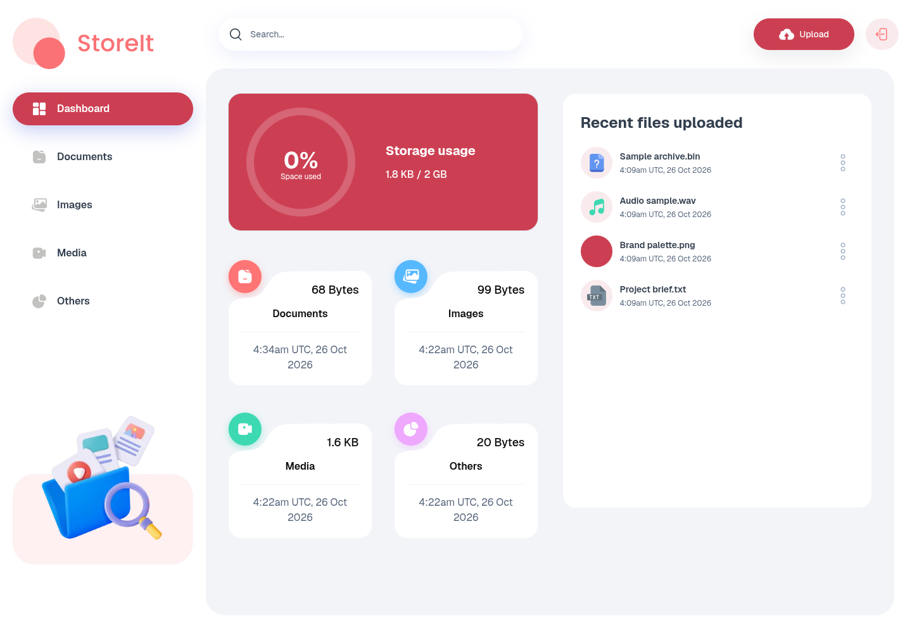
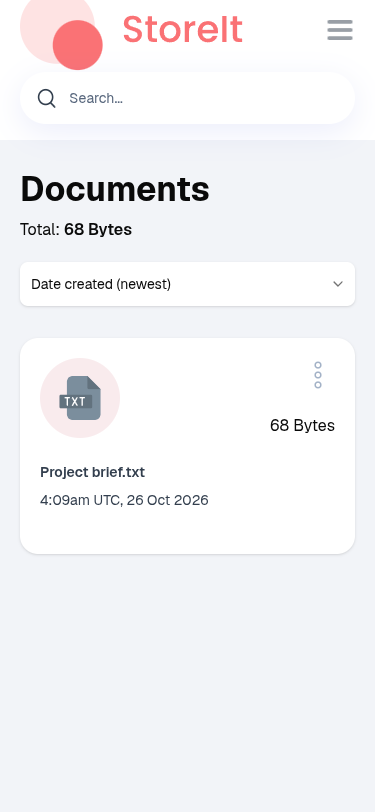
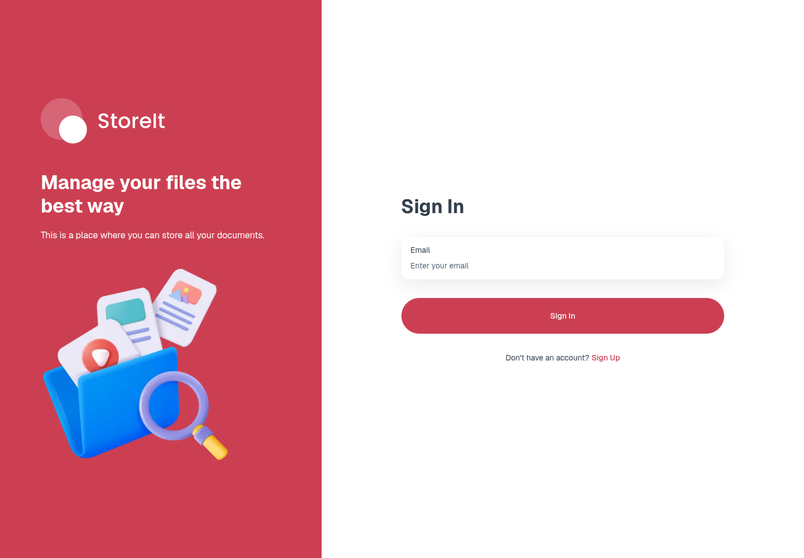
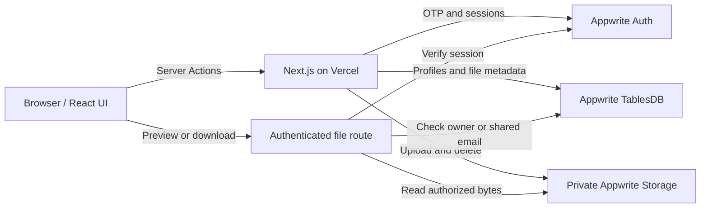

<div align="center">


# Your files, organized. Your access, controlled.

A full-stack file-storage application with email OTP authentication, private file delivery, sharing, and a responsive storage dashboard.

[](https://nextjs.org/)
[](https://react.dev/)
[](https://www.typescriptlang.org/)
[](https://appwrite.io/)
[](LICENSE)

**[Open the live app](https://storeit.vedanshu.dev)** · **[Setup](#run-locally)** · **[Architecture](#architecture)** · **[Verification](#verification)**

</div>

## Overview

StoreIt brings authentication, file management, and storage analytics into one application. Users sign in with an emailed code, upload files, browse by category, and share read access with other registered users. File operations run on the server, and downloads pass through an authenticated route that checks access on every request.

The project demonstrates Next.js App Router development, React interfaces, typed server actions, Appwrite data modeling, authorization, repeatable infrastructure setup, and Vercel deployment.

## Preview



<details>
<summary>Mobile interface and authentication</summary>





Screenshots show the deployed application. Personal account details are hidden; sample files contain no personal data.

</details>

## Features

- **Passwordless authentication** — email OTP sign-up and sign-in, resend support, session persistence, and sign-out.
- **File management** — drag-and-drop uploads, category browsing, previews, downloads, renaming, file details, and deletion.
- **Private access** — an authenticated file route checks ownership or the shared-email list before serving content. Appwrite buckets and tables have no direct client permissions.
- **Owner-controlled sharing** — add or remove shared email addresses; mutation permissions are checked independently on the server.
- **Sharing notifications** — an in-app bell inbox, unread counts, file links, and persistent read status. New shares refresh within 30 seconds while the tab is visible, on focus, or manually; revoked shares disappear.
- **Fast fuzzy search** — typo-tolerant filename suggestions run locally with Fuse.js against an authenticated metadata index; sorting supports creation date, name, and size.
- **Shared-file workspace** — a dedicated Shared files page, a separate dashboard section, and All files / My files / Shared with me filters on category pages.
- **Storage visibility** — usage summaries by file type, recent uploads, and a radial usage visualization.
- **Responsive interface** — desktop sidebar navigation and a mobile drawer with search, upload, and notification access. Loading states and short-lived route reuse keep navigation responsive.
- **Repeatable backend setup** — a resumable provisioning script creates and verifies the database, relationships, indexes, and private bucket.

## Architecture



The browser receives an HTTP-only session cookie after OTP verification. Server-side Appwrite clients use that session to establish identity; administrative requests use a scoped server key. File mutation actions derive identity from the session rather than trusting owner IDs submitted by the browser. Repeated identity checks are deduplicated within a single server render using React cache, without sharing authenticated identities across requests.

The authenticated `/api/search` and `/api/notifications` endpoints provide background metadata without placing periodic reads in the Server Action queue. Their responses are private and non-cacheable.

The `/api/files/[fileId]` route authorizes each read and returns private, non-cacheable responses. HTML and SVG uploads are downloaded as attachments. Private image previews bypass Next.js image optimization so requests retain the browser’s session cookie.

### Stack

| Layer              | Technology                                                   |
| ------------------ | ------------------------------------------------------------ |
| Application        | Next.js 16 App Router, React 19, TypeScript                  |
| UI                 | Tailwind CSS 4, Radix UI / shadcn components, Lucide         |
| Forms              | React Hook Form, Zod                                         |
| File selection     | React Dropzone                                               |
| Filename search    | Fuse.js, in-memory metadata index                            |
| Data visualization | Recharts                                                     |
| Backend            | Appwrite Auth, TablesDB, Storage; Node.js SDK                |
| Hosting            | Vercel, Node.js runtime                                      |
| Validation         | ESLint, TypeScript, Node.js test runner, live browser checks |

## Run locally

### Prerequisites

- Node.js **22 or newer** and npm.
- An Appwrite Cloud project and access to create its API keys.
- Network access during the production build to download the Geist font.

```bash
git clone https://github.com/vedanshun05/drive-clone-store-it.git
cd drive-clone-store-it
npm ci
cp .env.example .env.local
```

Fill in `.env.local`, provision the backend as described below, then start development:

```bash
npm run dev
```

Open **http://localhost:3000**. Create an account and verify the code sent to your email. A fresh backend starts with no user accounts or files.

### Environment variables

| Variable                                      | Purpose                                                 |
| --------------------------------------------- | ------------------------------------------------------- |
| `NEXT_PUBLIC_APPWRITE_ENDPOINT`               | Project API endpoint, including `/v1`                   |
| `NEXT_PUBLIC_APPWRITE_PROJECT_ID`             | Appwrite project ID                                     |
| `NEXT_PUBLIC_APPWRITE_PROJECT_NAME`           | Optional descriptive project name                       |
| `NEXT_PUBLIC_APPWRITE_DATABASE_ID`            | Database ID; default `store_it`                         |
| `NEXT_PUBLIC_APPWRITE_USERS_TABLE_ID`         | Profile table ID; default `users`                       |
| `NEXT_PUBLIC_APPWRITE_FILES_TABLE_ID`         | File metadata table ID; default `files`                 |
| `NEXT_PUBLIC_APPWRITE_NOTIFICATIONS_TABLE_ID` | Optional notification table ID; default `notifications` |
| `NEXT_PUBLIC_APPWRITE_BUCKET_ID`              | Storage bucket ID; default `store_it_files`             |
| `NEXT_APPWRITE_SECRET_KEY`                    | Private runtime API key                                 |
| `APPWRITE_SETUP_KEY`                          | Optional private provisioning key; local setup only     |

Never commit `.env.local`, expose API keys in client code, or prefix a secret with `NEXT_PUBLIC_`. The example environment file contains placeholders and resource IDs only.

## Provision Appwrite

1. Create a project in Appwrite Console and copy its project ID and regional API endpoint into `.env.local`.
2. Create a temporary **setup key** with the scopes printed by the command below, and save it as `APPWRITE_SETUP_KEY`.
3. Create a **runtime key** with `sessions.write`, `rows.read`, `rows.write`, `files.read`, and `files.write`; save it as `NEXT_APPWRITE_SECRET_KEY`.

```bash
# Print the exact scope lists without contacting Appwrite.
npm run backend:setup -- --scopes

# Create missing resources and wait for schema jobs to finish.
npm run backend:setup -- --apply

# Verify the existing schema and real application query shapes without writes.
npm run backend:setup
```

The setup command can be rerun after an interruption. It creates missing resources and rejects incompatible existing permissions or schema instead of silently changing them. It does not create accounts, seed user data, or upload files. Provisioning uses current varchar-column APIs and supported scalar indexes; shared-email queries are verified directly because Appwrite rejects explicit array-column indexes.

### Data model

| Resource         | Contents                                                                                             |
| ---------------- | ---------------------------------------------------------------------------------------------------- |
| `users`          | Full name, email, avatar URL, Appwrite account ID                                                    |
| `files`          | Name, type, extension, size, file URL, owner relationship, account ID, shared emails, bucket file ID |
| `notifications`  | Recipient email, file ID, event time, and read status; private server access only                    |
| `store_it_files` | Private uploaded file contents                                                                       |

`files.owner` is a many-to-one relationship to `users`. Unique indexes protect profile email/account IDs and storage-file metadata. Additional indexes support file filtering and sorting.

When upgrading an existing backend, run `npm run backend:setup -- --apply` before deploying to create the notification table and indexes. New shares create notifications; older shares are not backfilled. Notifications are in-app only, with no email or operating-system push delivery.

The provisioning key is used only for backend administration. Deploy the smaller runtime key to the application.

## Deploy to Vercel

1. Import this repository as a **Next.js** project.
2. Use the repository root, `master` as the production branch, `npm run build` as the build command, and Next.js’s default output directory.
3. Add the application variables from `.env.example` to the desired Vercel environments. Keep `APPWRITE_SETUP_KEY` local; deploy only the runtime key.
4. Keep Vercel Functions close to your Appwrite database. This repository uses Singapore (`sin1`) in `vercel.json` for its Singapore Appwrite endpoint; change it if your backend is elsewhere.
5. Deploy, then assign your production domains in the Vercel project’s domain settings.
6. Verify sign-up, OTP delivery, and authenticated file operations on the deployed domain.

This application needs a **Node.js runtime** for Appwrite and Server Actions. Static-export hosting does not support its backend features.

Current deployment: **https://storeit.vedanshu.dev**. The alternate hostname **https://drive-clone-store-it.vercel.app** also points to production. Login cookies are scoped to the hostname, so use one hostname consistently during a session.

## Verification

```bash
npm run lint
npm run typecheck
npm test
npm run build
npm start
```

The automated tests use mocked Appwrite and Next.js adapters and do not modify production accounts or files. They cover authentication guards, ownership checks, trusted upload identity, filename handling, sharing validation, notification authorization/read state, storage pagination, session behavior, private-file delivery, and repeatable backend provisioning.

See **[the verification record](docs/VERIFICATION.md)** for the live walkthrough, tested viewport sizes, known limits, and remaining checks.

### Commands

| Command                            | Purpose                             |
| ---------------------------------- | ----------------------------------- |
| `npm run dev`                      | Start the development server        |
| `npm run build`                    | Create a production build           |
| `npm start`                        | Run the production build            |
| `npm run lint`                     | Run ESLint                          |
| `npm run typecheck`                | Check TypeScript                    |
| `npm test`                         | Run automated regression tests      |
| `npm run backend:setup`            | Check the Appwrite backend          |
| `npm run backend:setup -- --apply` | Provision missing backend resources |

## Project structure

```text
app/
  (auth)/                  Sign-in and sign-up pages
  (root)/                  Dashboard and file-category pages
  api/files/[fileId]/       Authenticated previews and downloads
  api/search/              Private metadata index for local fuzzy search
  api/notifications/       Private sharing notification inbox
components/                Application and reusable UI components
lib/
  actions/                 Authentication and file Server Actions
  appwrite/                Server clients and configuration
  utils.ts                 File classification and formatting
scripts/setup-appwrite.mjs Backend provisioning and verification
tests/                     Regression tests with isolated adapters
public/assets/             Interface icons and illustrations
docs/                      Screenshots and verification notes
```

## Limits and operational notes

- **4 MiB per file.** Uploads pass through Server Actions; this limit leaves space below Vercel’s request-body ceiling. Raising Next.js’s limit alone does not increase Vercel’s platform limit. Larger uploads need a direct-to-storage flow.
- **2 GiB dashboard reference.** The usage chart visualizes storage against 2 GiB. A total per-account quota is not currently enforced; the per-file limit is enforced on both the client and server.
- **Search metadata stays in session memory.** The index refreshes every 30 seconds in visible tabs, on focus, and after file mutations. Navigation reuses each browser’s route cache for up to 30 seconds. File contents are authorized on every request, even if an old filename remains visible briefly.
- **Sharing grants read access.** Shared recipients must have an account with the matching email. Only the owner can rename, change sharing, or delete a file.
- **Upload progress can be hidden.** Dismissing a progress item does not cancel the server upload.
- **Backend retention matters.** Review the Appwrite organization’s plan and inactivity policy. Keep database exports and file backups separately from the source repository.
- **Further production hardening.** Application-level abuse controls, durable quota accounting, background orphan cleanup, and operational monitoring are useful next steps.

## Troubleshooting

| Symptom                                 | Check                                                                                                                           |
| --------------------------------------- | ------------------------------------------------------------------------------------------------------------------------------- |
| Vercel `DEPLOYMENT_NOT_FOUND`           | Confirm the hostname is assigned to the correct project and production deployment.                                              |
| Auth pages load but sign-in fails       | Inspect Vercel runtime logs, Appwrite project status, endpoint/project ID, key scopes, and email authentication settings.       |
| Appwrite `general_resource_blocked`     | Check the project’s status in its owning organization. Re-deploying the frontend does not restore a blocked or deleted backend. |
| Missing column/index errors             | Run `npm run backend:setup`; use `--apply` to create missing resources with the setup key.                                      |
| Production still uses old configuration | Redeploy after changing environment variables; `NEXT_PUBLIC_` values may be bundled at build time.                              |
| File URL returns 401                    | Sign in on the same hostname used for the file link.                                                                            |
| A shared file returns 404               | Confirm the signed-in email is still in the file’s shared-user list. Unauthorized files are hidden with 404.                    |

## License and acknowledgements

Original project code and documentation are available under the **[MIT License](LICENSE)**, copyright © 2026 Vedanshu Nishad.

Third-party libraries, fonts, trademarks, and visual assets retain their own terms. See **[third-party notices](THIRD_PARTY_NOTICES.md)** for attribution and asset-provenance notes.
